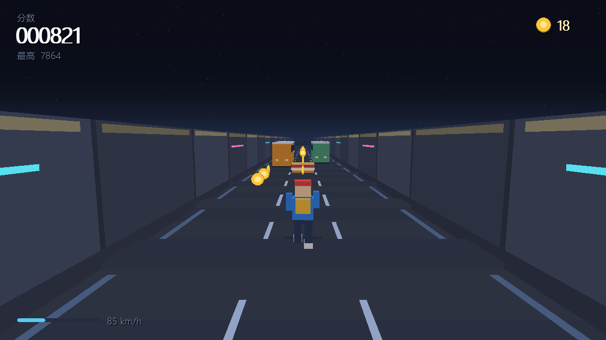

# 3D 地铁跑酷 · Python 复刻

用 **纯 Python + Pygame** 从零手写的 3D 无尽跑酷游戏。没有 Unity、没有 OpenGL、没有 3D 引擎——
每一帧的透视投影、背面剔除、近平面裁剪、深度排序、距离雾，都是本文件里几十行数学算出来的。



## 运行

```bash
pip install pygame      # 只依赖 pygame
python subway_run_3d.py
```

Windows / macOS / Linux 均可，Python 3.8+，1280×720 窗口，稳定 60 FPS。

## 操作

| 按键 | 动作 |
| --- | --- |
| `←` `→` / `A` `D` | 左右换道（三车道） |
| `↑` / `W` / `空格` | 跳跃，越过矮栏 |
| `↓` / `S` | 翻滚，从横杆下方滑过；空中按会快速下坠 |
| `P` | 暂停 / 继续 |
| `R` | 撞车后重新开始 |
| `Esc` | 退出 |

## 玩法

- 三条车道，速度随距离从 17 提升到 37 单位/秒，越跑越快。
- 三种障碍：**列车**（必须换道）、**矮栏**（跳过去）、**横杆**（滚过去）。
- 金币成串或成弧线分布，弧线金币正好对应跳跃轨迹，一次能吃到一串。
- 得分 = 距离 + 金币 × 10，最高分保存在 `~/.subway_run_3d.json`。
- 关卡由模式生成器实时拼装，每 25~35 单位生成一组，永远至少留一条可通行车道。

## 技术实现

文件只有一个 `subway_run_3d.py`，约 1100 行，顶部是常量，往下依次是渲染层和游戏层。

**1. 渲染管线**（`Renderer` / `Camera`）

```
世界坐标
  → 相机空间（与 right/up/fwd 三个基向量做点积）
  → 近平面裁剪（Sutherland–Hodgman，z ≥ 0.25）
  → 透视投影（f = H/2 / tan(FOV/2)）
  → 背面剔除（面法线 · 视线方向 < 0 才画）
  → 画家算法（按面心深度从远到近排序）
  → 双光源漫反射着色 + 距离雾混合
  → pygame.draw.polygon 填充
```

- **雾**：`depth` 超过 28 开始向雾色混合，110 处完全融入，远景自然消失在地平线，
  同时起到"远处刷怪看不见"的遮挡作用。
- **排序偏移**：地面、车道线、墙体各带一个 `bias`，保证共面图元不会互相闪烁。
- **无深度缓冲**：靠画家算法 + 凸多面体本身不会自遮挡的特性，代价是几十行代码换 60 FPS。

**2. 场景滚动**

角色永远站在 `z = 0`，是**世界向后移动**而不是角色向前跑——这样跑再远也不会有浮点精度问题。
地面砖块 / 车道虚线 / 墙面全部不存储坐标，只用 `travel % 段长` 算偏移，
所以无限长的隧道实际上只有几十个四边形在循环使用。

**3. 角色**

13 个立方体拼出来的低多边形小人（头、帽、帽檐、帽兜、躯干、胯、双臂、双腿、双脚、背包），
跑动时手脚按 `sin(phase)` 前后摆动，跳跃时收腿，翻滚时整体压到 0.86 高。

**4. 碰撞**

AABB 三轴重叠检测。玩家 z 向有 0.9 的厚度，单帧最大位移 0.62，因此不需要连续碰撞检测，
只留一点点扫掠余量。

## 一些数字

- 每帧约 **550 个多边形**，单帧渲染 **5~8 ms**（i5 级别 CPU），留给逻辑的时间很充裕。
- 机器人自动测试：连续跑 6 分钟，只撞车 5 次，最远 3785 米——说明关卡生成没有死局。

## 可以继续玩的方向

- 音效（拾取 / 跳跃 / 撞击）与背景音乐
- 滑板、磁铁、跳跃鞋等道具
- 弯道与上下坡（给相机加 yaw/pitch 曲线即可）
- 天空盒换成城市夜景贴图
- 手机触屏版（滑动手势映射到四个按键）

---

纯手写渲染的目的不是和引擎比性能，而是把"3D 画面到底是怎么算出来的"这件事摊开来看。
想改配色就改顶部那几行常量，想加一种障碍物就在 `spawn_pattern` 里加一个分支。
